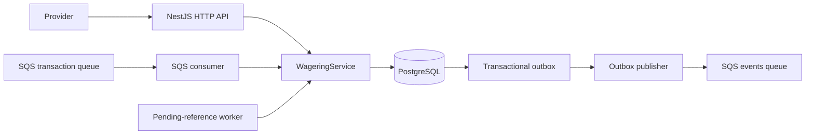
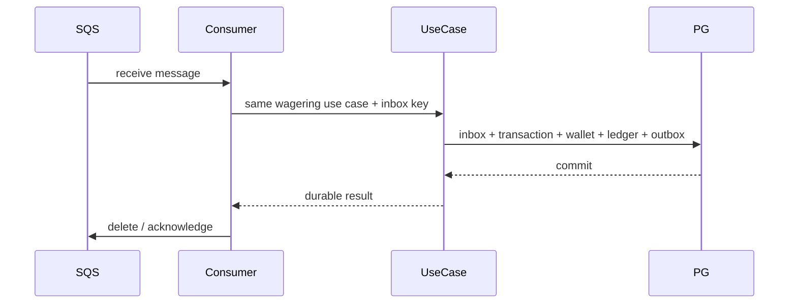

# Architecture and decisions

## Boundaries

The domain layer contains `Money`, `Wallet`, transaction state, ledger validation, and event types without NestJS, MikroORM, or AWS dependencies. `WageringService` coordinates application workflows through a SQL executor port. The MikroORM PostgreSQL connection owns transaction boundaries; SQL adapters keep database constraints explicit. HTTP and SQS are separate adapters calling the same wagering use case.



## Financial representation

`Money` stores integer minor units as `bigint`. Inputs are canonical decimal strings with exactly two fraction digits; binary floating-point never participates in monetary math. Currency acceptance uses the runtime's ISO-4217 currency registry (`Intl.supportedValuesOf`). PostgreSQL stores exact values in `numeric(18,2)`. Inputs exceeding that precision fail rather than rounding.

The database uses non-negative wallet/ledger checks, arithmetic ledger checks, currency-aware composite foreign keys, unique wallet identity and transaction/idempotency keys, plus triggers rejecting ledger `UPDATE`, `DELETE`, and `TRUNCATE`. A rejected request may retain a non-existent or mismatched attempted `wallet_id` for audit; the ledger composite foreign keys require every posted entry to belong to both the real wallet and its transaction. A balance update, transaction state, ledger insertion and outbox insertion are committed in one PostgreSQL transaction.

## Locking and retry policy

The unit of concurrency is `wallet_id`. Financial processing selects only the target wallet `FOR UPDATE`; unrelated wallets proceed independently. Every application instance uses the same PostgreSQL lock. `version` increments only when the balance changes and is included in balance-change events. Transactions set a 3-second lock timeout and a 15-second statement timeout. Serialization failures and deadlocks retry at most twice with bounded jitter; other errors are surfaced without retry.

The API stores the response balance snapshot on the transaction. Replays return that saved outcome, not the current wallet balance. Idempotency keys are unique per provider and distinct from provider external transaction IDs, which have their own unique constraint. SHA-256 is computed from a recursively key-sorted JSON object containing provider, external transaction, player, wallet, round, game, kind, money and optional reference; the idempotency key and transport metadata are excluded.

## Reversals

`REFUND` credits the full amount of a processed `BET`. `ROLLBACK` reverses the direction of a processed `BET`, `WIN`, or `REFUND`; the amount must match exactly. A partial reversal is not supported. PostgreSQL permits one successful reversal per `(reference, reversal kind)`, enforced by a partial unique index. Thus the model follows the challenge's explicit "once per same type" rule; a single BET may have one REFUND and one ROLLBACK if the provider submits both. Each reversal is separately audited and is still subject to the wallet non-negative constraint.

Missing or still-pending references remain `PENDING_REFERENCE`. A worker polls due rows with row-level coordination, retries with exponential backoff, and rejects after 12 attempts using `REFERENCE_NOT_FOUND`. A reference already present but mismatched by provider, player, wallet, currency, or round is rejected immediately as `INVALID_REFERENCE`, even while the reference transaction itself is pending. A reference that is terminal but not processed is rejected as `REFERENCE_NOT_PROCESSED`.

## Inbox, outbox, and delivery

SQS transactions are deduplicated durably by `(consumer_name, message_id)`. Inbox insertion, wagering result, ledger, wallet and events share a single SQL transaction. The SQS consumer deletes a message only after the use case commits. Infrastructure failures leave messages visible for retry; malformed envelopes are moved to the DLQ. LocalStack redrive policy caps receive attempts at five.

Integration events are serialized into the outbox in the financial transaction. Publishers claim rows using `FOR UPDATE SKIP LOCKED` and an expiring claim, publish outside the SQL transaction, then mark the row published. A crash after SQS accepts a message but before the SQL update can produce a duplicate, so downstream event consumers must deduplicate by `eventId`. No event is published before commit. Failures use exponential backoff; after 20 failed attempts the row remains durable and is marked for operator review rather than being retried forever or deleted.

## API, auth, and operations

HTTP DTO validation rejects malformed contracts; the global exception filter maps invalid input, conflicts, business rejection and transient infrastructure failures to stable response codes. `GET /health/live` checks only process liveness. `GET /health/ready` checks PostgreSQL and SQS. `/metrics` exposes durable transaction status, pending outbox and pending-reference gauges without high-cardinality identifiers.

The API assigns or accepts a validated `x-correlation-id` and returns it in the response header. Transaction and SQS failure logs include available message, transaction, wallet, and provider identifiers as structured JSON without logging monetary payloads.

Authentication is intentionally omitted because it is not scored by the challenge. `ProviderIdentityPort` is the explicit integration seam for an OIDC-backed provider identity guard. Health endpoints remain public. The current API is therefore suitable only for a trusted local environment until that adapter is configured.

## Known limitations

- The integration and concurrency suites require an explicitly configured disposable PostgreSQL database and LocalStack for the SQS redelivery case.
- LocalStack queues are configured for local development; production queue policies, IAM and secret injection must be supplied by deployment infrastructure.
- The pending-reference worker uses a fixed 12-attempt policy and does not expose a per-provider override.
- Metrics are exposed per process; scrape every API/worker instance to aggregate in-process retry, DLQ, lock-conflict, and latency histogram values.
- The service does not include authentication, OIDC configuration, or user management. Reconciliation reads the materialized balance and ledger aggregate in one SQL statement so concurrent commits cannot produce a mixed-snapshot false alarm.

## Sequence: synchronous transaction

```mermaid
sequenceDiagram
  participant API
  participant UseCase
  participant PG as PostgreSQL
  participant Outbox
  API->>UseCase: request + Idempotency-Key
  UseCase->>PG: begin; insert unique transaction
  UseCase->>PG: lock wallet FOR UPDATE
  UseCase->>PG: update wallet + ledger + result + events
  PG-->>UseCase: commit
  UseCase-->>API: persisted result snapshot
  Outbox->>PG: claim with SKIP LOCKED
  Outbox->>Outbox: publish event after commit
```

## Sequence: asynchronous SQS transaction



## ADR index

- [ADR 0001: wallet-level PostgreSQL locking](./docs/adr/0001-wallet-locking.md)
- [ADR 0002: database-backed idempotency](./docs/adr/0002-persistent-idempotency.md)
- [ADR 0003: transactional outbox](./docs/adr/0003-transactional-outbox.md)
